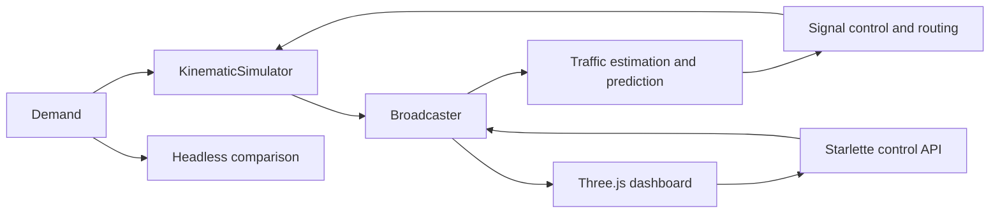

# UrbanFlow AI architecture

`python run_demo.py` starts the Starlette application under Uvicorn. The
default address is http://127.0.0.1:8001. Host and port come from
`urbanflow/config.py`, with environment overrides.

- `urbanflow/core/` contains the road graph, demand schedules, junction FSMs,
  vehicle physics, trip accounting and route planner.
- `urbanflow/intelligence/` estimates traffic state, predicts spillback and
  implements fixed-time, actuated, max-pressure and cooperative predictive
  signal control. The FSM applies phase requests with clearance intervals.
- `urbanflow/server/` serves static assets and HTTP endpoints and broadcasts
  snapshots over `/ws/live`. The live app has one shared simulator and
  broadcaster, so tabs operate the same run.
- `urbanflow/web/` contains the vanilla JavaScript dashboard and vendored
  Three.js in `vendor/`. The renderer interpolates vehicle poses between
  server snapshots.
- `data/` contains map assets, demand inputs, trained traffic predictors
  and archived external SUMO benchmark results. The live controller list
  currently consists of the four controllers above.
- `tests/` includes simulator, API, research pipeline and campaign contract
  checks. Run `python -m pytest tests -q` after installing
  `requirements-dev.txt`.
